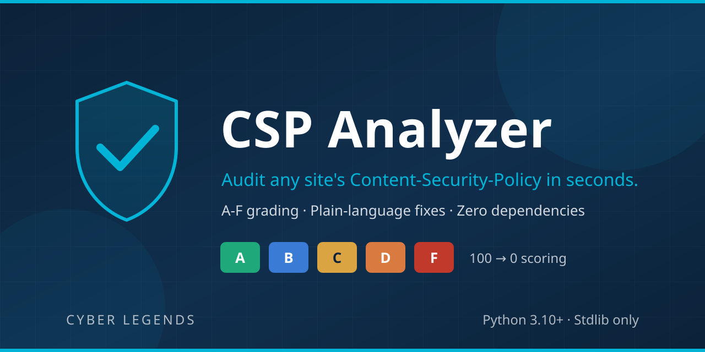
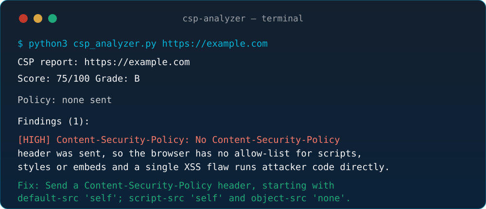
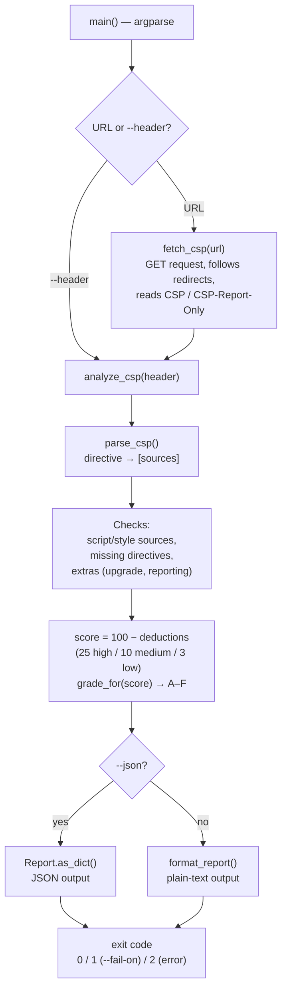

<p align="center">
  
</p>

<h1 align="center">CSP Analyzer</h1>

<p align="center"><strong>Audit any website's Content-Security-Policy header in seconds, get an A-F grade, and learn exactly how to fix it.</strong></p>

<p align="center">
  <a href="LICENSE"></a>
  <a href="https://github.com/sajidhussainraza/csp-analyzer/releases"></a>
  <a href="https://github.com/sajidhussainraza/csp-analyzer/stargazers"></a>
  <a href="https://github.com/sajidhussainraza/csp-analyzer/network/members"></a>
  <a href="https://github.com/sajidhussainraza/csp-analyzer/issues"></a>
  <a href="https://github.com/sajidhussainraza/csp-analyzer/commits/main"></a>
  <a href="https://github.com/sajidhussainraza/csp-analyzer/actions/workflows/ci.yml"></a>
  <a href="https://www.python.org/downloads/"></a>
  <a href="CONTRIBUTING.md"></a>
</p>

<p align="center">
  <a href="#demo">Demo</a> |
  <a href="#quick-start">Quick Start</a> |
  <a href="#installation">Install</a> |
  <a href="docs/demo-capture.md">Docs</a> |
  <a href="https://github.com/sajidhussainraza/csp-analyzer/issues/new?template=bug_report.yml">Report Bug</a> |
  <a href="https://github.com/sajidhussainraza/csp-analyzer/issues/new?template=feature_request.yml">Request Feature</a>
</p>

## Why this exists

**Problem:** a weak Content-Security-Policy lets one XSS flaw run attacker code in your visitors' browsers, and most sites never check the header they actually send.
**Solution:** this dependency-free Python CLI fetches the header, checks it against the standard hardening rules, and grades it A-F with a plain-language fix for every finding.
**Result:** you know in seconds whether a site's CSP would stop an attack, and exactly which directive to change first.

## Demo



> Static preview, not an animated GIF: the image above is a rendering of
> real output (the full output is saved in
> [`examples/sample-output-example.com.txt`](examples/sample-output-example.com.txt)).
> A real demo GIF has not been recorded yet; the exact capture script is in
> [`docs/demo-capture.md`](docs/demo-capture.md).

## Features

- 🔒 **A-F grading with a 0-100 score** — compare any two Content-Security-Policy headers at a glance, and track a policy as you tighten it
- 🗣️ **Plain-language findings, each with a fix** — no jargon, no guessing what to change next
- 🧨 **Catches the dangerous patterns** — `'unsafe-inline'`, `'unsafe-eval'`, wildcard (`*`), `http:`, `https:` and `data:` sources in `script-src`
- 🕳️ **Checks the directives everyone forgets** — `default-src`, `object-src`, `base-uri`, `frame-ancestors`, `form-action`, `upgrade-insecure-requests`, and violation reporting
- 📋 **Report-Only aware** — tells you when a policy only logs violations instead of blocking them
- 🧠 **Smart about modern policies** — understands the `default-src` fallback for `object-src`, and that `'strict-dynamic'` with a nonce neutralises `'unsafe-inline'` in modern browsers
- 📴 **Offline mode** — audit any header string with `--header`, no network needed
- 🤖 **CI ready** — `--json` for machine-readable output and `--fail-on` to fail a build on findings above a severity, so a weak CSP can block a deploy
- 🪶 **Zero dependencies** — Python standard library only, nothing to install, nothing to update

## Table of contents

- [Quick Start](#quick-start)
- [Installation](#installation)
- [Usage](#usage)
- [CLI reference](#cli-reference)
- [Configuration](#configuration)
- [How grading works](#how-grading-works)
- [What it checks](#what-it-checks)
- [Live results](#live-results)
- [Architecture](#architecture)
- [Project structure](#project-structure)
- [Teaching notes](#teaching-notes)
- [Tests](#tests)
- [FAQ](#faq)
- [Roadmap](#roadmap)
- [Contributing](#contributing)
- [License](#license)
- [Acknowledgements](#acknowledgements)

## Quick Start

The fastest path to a working result, under 60 seconds. You need only
Python 3.10+; there is nothing to install.

```bash
git clone https://github.com/sajidhussainraza/csp-analyzer.git
cd csp-analyzer
python3 csp_analyzer.py https://example.com
```

Expected output (real output, captured 20 November 2026):

```
CSP report: https://example.com
Score: 75/100  Grade: B

  Policy: none sent

Findings (1):
  [HIGH] Content-Security-Policy: No Content-Security-Policy header was sent, so the browser has no allow-list for scripts, styles or embeds and a single XSS flaw runs attacker code directly.
        Fix: Send a Content-Security-Policy header, starting with default-src 'self'; script-src 'self' and object-src 'none' as a minimum.
```

No CSP header at all still scores 75/100 (B), because a missing header
is one high finding (minus 25), not an automatic zero. See
[How grading works](#how-grading-works) and the [FAQ](#faq).

## Installation

### Prerequisites

| Requirement | Version | Notes |
| --- | --- | --- |
| Python | 3.10 or newer | 3.10+ is required: the code uses `str \| None` annotations (PEP 604). Check with `python3 --version`. |
| Git | Any recent version | Only needed to clone the repo; you can also download the ZIP from GitHub. |
| Internet access | — | Only needed to audit a live URL. `--header` mode works fully offline. |
| Third-party packages | None | Standard library only (`urllib`, `ssl`, `json`, `argparse`). There is no `requirements.txt` because there is nothing to install. |

### Windows

```powershell
git clone https://github.com/sajidhussainraza/csp-analyzer.git
cd csp-analyzer
py csp_analyzer.py https://example.com
```

Use `py` (the Python launcher) if `python3` is not recognised. On
Windows, `python` usually works too.

### macOS

```bash
git clone https://github.com/sajidhussainraza/csp-analyzer.git
cd csp-analyzer
python3 csp_analyzer.py https://example.com
```

macOS ships a system Python that may be older than 3.10. If
`python3 --version` reports below 3.10, install a newer Python from
[python.org](https://www.python.org/downloads/) or with
`brew install python`.

### Linux

```bash
git clone https://github.com/sajidhussainraza/csp-analyzer.git
cd csp-analyzer
python3 csp_analyzer.py https://example.com
```

Most current distributions already ship Python 3.10+. On Debian/Ubuntu,
`sudo apt install python3` gets you a working interpreter.

### Install from source

There is no package to install and no build step. Cloning the repo
*is* the install: `csp_analyzer.py` is a single self-contained file.
Copy it anywhere and run it:

```bash
cp csp_analyzer.py /usr/local/bin/csp-analyzer   # optional, Linux/macOS
chmod +x /usr/local/bin/csp-analyzer
csp-analyzer https://example.com
```

### Verify the install

```bash
python3 tests/run_tests.py   # 27 tests, including a live audit of github.com
python3 csp_analyzer.py --header "default-src 'self'; script-src 'self'"
```

The second command should print `Score: 78/100  Grade: B` and exit 0.
If the live test is skipped, the network was unreachable; the other
26 tests still prove the install works.

### Troubleshooting

| Error | Cause | Fix |
| --- | --- | --- |
| `python3: command not found` | Python is not installed, or not on PATH | Install Python 3.10+ from python.org; on Windows use `py` instead of `python3` |
| `Error: URL must start with http:// or https://` (exit 2) | The URL was missing its scheme | Run `python3 csp_analyzer.py https://example.com`, not `example.com` |
| `Error: could not reach the site (...)` (exit 2) | The site is down, the network is off, or a proxy blocks the request | Check the URL in a browser; retry on a working network |
| `Error: Give a URL to audit or a header with --header` (exit 2) | No URL and no `--header` were given | Give one or the other, not neither |
| `Error: --header and a URL cannot be used together` (exit 2) | Both were given at once | Audit the URL, or the header string, in separate runs |
| `SyntaxError` on `str \| None` | Python older than 3.10 | Upgrade to Python 3.10+; this syntax (PEP 604) does not work on 3.8/3.9 |
| `SSLError` / certificate errors | The site's certificate is invalid, or a corporate proxy intercepts TLS | That is a finding about the site, not this tool; audit the header with `--header` instead |

## Usage

### Basic: audit a live site

This CSP header audit fetches the site's real response headers and
grades the Content-Security-Policy it sends. It is the core use case
for this CSP checker: a quick web security check of any site's security
headers.

```bash
python3 csp_analyzer.py https://github.com
```

```
CSP report: https://github.com
Score: 87/100  Grade: B
...
Findings (2):
  [MEDIUM] style-src: style-src allows 'unsafe-inline', so injected styles can exfiltrate data or restyle the page.
        Fix: Move inline styles to external files, or protect them with a nonce or hash.
  [LOW] report-uri: No report-uri or report-to, so CSP violations are never reported back and a broken policy goes unnoticed.
        Fix: Add report-to (or report-uri) pointing at an endpoint that collects violation reports.
```

The full output for this audit is saved in
[`examples/sample-output-github.com.txt`](examples/sample-output-github.com.txt).

### Intermediate: audit a header offline, and get JSON

Analyse a header value directly. Nothing is fetched, so this works
offline and is ideal for testing a policy before you deploy it:

```bash
python3 csp_analyzer.py --header "default-src 'self'; script-src 'self'"
```

```
CSP report: CSP header analysis
Score: 78/100  Grade: B

  Policy: default-src 'self'; script-src 'self'

Findings (5):
  [MEDIUM] frame-ancestors: No frame-ancestors, so the page can be framed by any site (clickjacking).
        Fix: Add frame-ancestors 'self' (or 'none' if the page must never be framed).
  [LOW] base-uri: No base-uri, so an injected <base> tag can redirect every relative URL on the page.
        Fix: Add base-uri 'self' (or 'none' if the page uses no relative URLs).
  [LOW] form-action: No form-action, so forms can submit credentials to any origin.
        Fix: Add form-action 'self' unless a form genuinely posts elsewhere.
  [LOW] upgrade-insecure-requests: No upgrade-insecure-requests, so a stray http:// resource on the page still loads over plain HTTP.
        Fix: Add upgrade-insecure-requests so browsers upgrade insecure subresources automatically.
  [LOW] report-uri: No report-uri or report-to, so CSP violations are never reported back and a broken policy goes unnoticed.
        Fix: Add report-to (or report-uri) pointing at an endpoint that collects violation reports.
```

Machine-readable output for scripts and dashboards:

```bash
python3 csp_analyzer.py --header "default-src *; script-src * 'unsafe-inline' 'unsafe-eval'" --json
```

```json
{
  "url": null,
  "status": null,
  "header": "default-src *; script-src * 'unsafe-inline' 'unsafe-eval'",
  "report_only": false,
  "score": 0,
  "grade": "F",
  "findings": [
    {
      "severity": "high",
      "directive": "script-src",
      "message": "script-src allows *, which is a wildcard that allows the resource from any origin.",
      "fix": "List the exact hosts the site needs instead of *."
    }
  ]
}
```

(Only the first finding is shown; the full output lists every finding.)

### Advanced: use it as a CI security gate

Fail a build when the policy has high-severity findings, for example
in a GitHub Actions step after deploying a preview site:

```bash
python3 csp_analyzer.py https://staging.example.com --fail-on high
echo $?   # 1: a high-severity finding was found; 0: clean at that level
```

Combine it with `--json` to feed the findings into your own reporting:

```bash
python3 csp_analyzer.py https://staging.example.com --json --fail-on medium > csp-report.json
```

#### Exit codes

| Code | Meaning |
| --- | --- |
| 0 | No findings at or above `--fail-on` |
| 1 | Findings at or above `--fail-on` were found |
| 2 | Usage error (bad URL, site unreachable) |

Note: the analyzer only reads the header a site sends on an anonymous
visit. It cannot audit a policy served only after login, or one applied
by JavaScript in the browser.

## CLI reference

| Flag / argument | Description |
| --- | --- |
| `url` (positional) | Website URL to audit, e.g. `https://example.com`. Must start with `http://` or `https://`. |
| `--header TEXT` | Analyse a CSP header value directly (no network needed). Cannot be combined with a URL. |
| `--json` | Print the report as JSON instead of plain text. |
| `--fail-on {high,medium,low,none}` | Exit 1 when findings at or above this severity are found. Default: `none` (always exit 0 unless there is a usage or network error). |
| `-h`, `--help` | Show the built-in help and exit. |

There is no `--version` flag yet; the version is in `__version__`
at the top of `csp_analyzer.py` (currently `1.0.0`). Adding one is on
the [roadmap](#roadmap).

## Configuration

There is no configuration file and no environment variable to set.
Every behaviour is controlled by the command-line flags above.

| Option | Type | Default | Description |
| --- | --- | --- | --- |
| `url` | string | — | Site to audit. |
| `--header` | string | — | Header value to analyse offline. |
| `--json` | flag | off | JSON output instead of plain text. |
| `--fail-on` | `high` / `medium` / `low` / `none` | `none` | Severity threshold that makes the exit code 1. |
| Request timeout | — | 15 seconds | Fixed in `fetch_csp`; not currently configurable (see roadmap). |
| User-Agent | — | `csp-analyzer/1.0` | Sent with the audit request. |

No secrets are involved anywhere: the tool sends only an anonymous
read-only GET request and stores nothing.

## How grading works

Score starts at 100 and deducts **25 / 10 / 3** per high / medium / low
finding:

| Score | Grade |
| --- | --- |
| 90-100 | A |
| 75-89 | B |
| 60-74 | C |
| 40-59 | D |
| 0-39 | F |

Findings are graded by severity:

| Severity | Examples |
| --- | --- |
| High | No CSP header at all, `'unsafe-inline'` / `'unsafe-eval'` in `script-src`, `*` or `data:` in `script-src` |
| Medium | Report-Only header only, `http:` / `https:` in `script-src`, `'unsafe-inline'` in `style-src`, missing `default-src` / `object-src` / `frame-ancestors` |
| Low | Missing `base-uri` / `form-action` / `upgrade-insecure-requests` / reporting, deprecated `report-uri` |

## What it checks

| Check | What a good result looks like |
| --- | --- |
| Header present | An enforcing Content-Security-Policy header is sent, not just a Report-Only one |
| `script-src` | No `'unsafe-inline'`, `'unsafe-eval'`, `*`, `http:`, `https:` or `data:`; a nonce or hash where inline scripts are needed |
| `style-src` | No `'unsafe-inline'` (including via the `default-src` fallback) |
| `default-src` | A fallback such as `'self'` or `'none'` so forgotten directives do not default to anywhere |
| `object-src` | `'none'`, or a strict `default-src` that covers it |
| `base-uri` | `'self'` or `'none'`, so an injected `<base>` tag cannot redirect relative URLs |
| `frame-ancestors` | `'self'` or `'none'`, so the page cannot be framed (clickjacking) |
| `form-action` | `'self'`, so forms cannot post credentials to any origin |
| `upgrade-insecure-requests` | Present, so stray `http://` resources upgrade automatically |
| Reporting | A `report-to` (or `report-uri`) endpoint collects violation reports |

Two subtleties are handled, not just pattern-matched:

- `object-src` falls back to `default-src`, so a strict
  `default-src 'none'` already locks plugins down and is not
  flagged. `base-uri`, `frame-ancestors` and `form-action` do not
  fall back, so they are always checked on their own.
- With `'strict-dynamic'` plus a nonce, modern browsers ignore
  `'unsafe-inline'`, so it drops from High to Low. `'unsafe-eval'`
  is never neutralised that way and stays High.

Known limitation: when a dangerous source comes from the `default-src`
fallback, the finding is still attributed to `script-src` (or
`style-src`). The message and the fix are correct; only the label
names the effective directive rather than the directive that literally
contains the source.

## Live results

Real audits, captured 19 November 2026 and re-checked 20 November 2026.
Full outputs are saved in [`examples/`](examples/).

| Site | Score | Grade | What stood out |
| --- | --- | --- | --- |
| [github.com](https://github.com) | 87/100 | B | Nonce-based `script-src`, but `'unsafe-inline'` in `style-src` and no reporting endpoint |
| [google.com](https://www.google.com) | 13/100 | F | Report-Only, nonce-based policy (see below) |
| [example.com](https://example.com) | 75/100 | B | No CSP header at all |

Google's F deserves a careful read rather than a laugh: its homepage
policy is Report-Only and nonce-based, so modern browsers do enforce
the nonce even though the header as sent is loose (`'unsafe-eval'`,
`https:` / `http:` fallbacks, no `frame-ancestors`). The score grades
the header as sent; the teaching point is that a Report-Only policy
blocks nothing, whatever its nonce says.

## Architecture



The tool is a single file with no dependencies: `fetch_csp` does the
one network call, `analyze_csp` is a pure function of the header value
(so it is easy to test offline), and the output layer is separate from
the analysis.

## Project structure

```
csp-analyzer/
├── csp_analyzer.py          # The whole tool: fetch, analyse, grade, report
├── README.md                # This file
├── LICENSE                  # MIT
├── CHANGELOG.md             # Version history (Keep a Changelog + SemVer)
├── CONTRIBUTING.md          # How to contribute
├── CODE_OF_CONDUCT.md       # Contributor Covenant 2.1
├── SECURITY.md              # How to report a vulnerability
├── .gitignore               # Python / editor / OS artefacts
├── .editorconfig            # Indentation and line endings
├── assets/
│   ├── banner.svg           # README banner (1280x640)
│   ├── logo.svg             # Square logo, works at 64px
│   ├── demo.svg             # Static terminal preview shown above
│   └── social-preview.png   # GitHub social preview (local file, upload via the web UI)
├── docs/
│   ├── banner.png           # High-resolution banner (local file, upload via the web UI)
│   └── demo-capture.md      # Exact script for recording a real demo.gif
├── examples/
│   ├── sample-output-example.com.txt
│   ├── sample-output-github.com.txt
│   └── sample-output-google.com.txt
├── tests/
│   ├── test_csp_analyzer.py # 27 tests (stdlib unittest)
│   └── run_tests.py         # Test runner, no pytest needed
└── .github/
    ├── ISSUE_TEMPLATE/
    │   ├── bug_report.yml
    │   ├── feature_request.yml
    │   └── config.yml
    ├── PULL_REQUEST_TEMPLATE.md
    └── workflows/
        └── ci.yml           # Tests on Ubuntu / Windows / macOS, Python 3.10-3.13
```

## Comparison with alternatives

Skipped: no competing tools were given to compare against, so there is
no comparison table here. If you know a CSP checker this should be
measured against, open a
[feature request](https://github.com/sajidhussainraza/csp-analyzer/issues/new?template=feature_request.yml)
and it can be added with real, verifiable numbers.

## Teaching notes

This tool pairs well with a lesson on XSS prevention in depth: run it
against a deliberately loose demo policy, then tighten one directive
at a time and watch the grade move. Good discussion points:

- Why CSP is the second line of defence after input validation: one
  missed sanitisation flaw still needs a policy that refuses to run
  the injected script.
- Why `'unsafe-inline'` is the directive that matters most: with it,
  an attacker does not need to host anything, the payload runs inline.
- Why nonces and hashes replaced `'unsafe-inline'`: they let a page
  keep its few inline scripts while refusing every script the server
  did not bless.
- Why `default-src` is the safety net: every directive you forget
  inherits it, so `'self'` there turns an oversight into a block.
- Why a Report-Only policy is a rehearsal, not a defence: it logs
  violations while letting the attack through, so it must graduate
  to an enforcing header.
- Why `frame-ancestors` replaced `X-Frame-Options`: it covers the
  same clickjacking case with a single CSP directive.

## Tests

```bash
python3 tests/run_tests.py   # 27 tests, including a live audit of github.com
```

27/27 tests pass. The mock and CLI tests need no internet. The live
test runs a real audit against github.com and is skipped automatically
when the network is unreachable. (pytest is also supported if it is
installed: `python3 -m pytest tests/ -q`.)

## FAQ

**Why does example.com score 75/100 (B) with no CSP header at all?**
A missing header is one high finding, worth minus 25. The score grades
the header as sent; it does not claim the site is safe. A site with no
header and a site with a bad header can both be exploited — the grade
tells you how much is wrong, not whether an attack is possible.

**Why does google.com score 13/100 (F) when Google is clearly secure?**
The score grades the header as sent on the homepage, and that header
is Report-Only with `'unsafe-eval'` and `https:` / `http:` fallbacks.
Google's real defence is the nonce plus layers this tool cannot see
(server-side validation, other headers). The F is a teaching point,
not a verdict on Google: a Report-Only policy blocks nothing.

**Does this tool fix my policy for me?**
No. It tells you exactly what is wrong and how to fix each finding.
You change the header on your own server. A future `--suggest` mode
that prints a tightened policy is on the roadmap.

**Can it audit a site behind a login?**
No. It sends one anonymous GET request and reads the response headers.
A policy served only after login, or applied by JavaScript in the
browser, is invisible to it. Paste the header into `--header` mode
instead.

**What is the difference between Report-Only and enforcing?**
An enforcing `Content-Security-Policy` header blocks violations.
A `Content-Security-Policy-Report-Only` header only logs them. Use
Report-Only while testing a new policy, then move it to the enforcing
header, or the policy protects nothing.

**Why is `'unsafe-inline'` in `style-src` only medium, not high?**
Inline styles can exfiltrate data and restyle a page, but they cannot
run code the way inline scripts can. Inline scripts with
`'unsafe-inline'` are high because any injected `<script>` runs.

**Does it work on Windows?**
Yes. Any machine with Python 3.10+ runs it; use `py` instead of
`python3` if that is how Python is launched on your machine. CI tests
it on Ubuntu, Windows, and macOS.

**Can I use it in CI?**
Yes. `--json` gives machine-readable output and `--fail-on` turns
findings into a failing build. See
[Advanced usage](#advanced-use-it-as-a-ci-security-gate).

## Roadmap

- [ ] Record a real `demo.gif` (capture script: [`docs/demo-capture.md`](docs/demo-capture.md))
- [ ] Add a `--version` flag (the version exists as `__version__` but has no flag yet)
- [ ] Add a `--timeout` flag for the audit request (currently fixed at 15 seconds)
- [ ] Add a `--suggest` mode that prints a tightened policy for the audited site
- [ ] Check `trusted-types` and `require-trusted-types-for` for DOM XSS defence
- [ ] Apply the `default-src` fallback consistently to `worker-src`, `connect-src`, `img-src`, and `media-src` wildcard checks
- [ ] Attribute fallback findings to the directive that actually contains the source
- [ ] HTML report output alongside text and JSON
- [ ] Publish to PyPI (only if there is demand; the single-file script works fine as-is)

## Contributing

Contributions are welcome. See [CONTRIBUTING.md](CONTRIBUTING.md) for
the full guide. The short version:

1. Fork the repository and create a branch for your change.
2. Keep the tool dependency-free (Python standard library only).
3. Add or update tests in `tests/` for any behaviour you change.
4. Run the full suite and make sure all 27 tests pass:
   `python3 tests/run_tests.py`
5. Open a pull request describing the change and why it helps.

Please also follow the [Code of Conduct](CODE_OF_CONDUCT.md), and
report security issues privately as described in
[SECURITY.md](SECURITY.md) — do not open a public issue for them.

## License

MIT. See [LICENSE](LICENSE) for the full text.

## Acknowledgements

- The [MDN Content-Security-Policy guide](https://developer.mozilla.org/en-US/docs/Web/HTTP/CSP)
  for the reference behaviour this tool checks against.
- The [Contributor Covenant](https://www.contributor-covenant.org/) for
  the Code of Conduct, and [Keep a Changelog](https://keepachangelog.com/)
  for the changelog format.
- Everyone who reports a wrong score with a real header to back it up:
  that is how the checks get better.

## Star history

[](https://star-history.com/#sajidhussainraza/csp-analyzer&Date)

## Contributors

[](https://github.com/sajidhussainraza/csp-analyzer/graphs/contributors)

---

Built by [Cyber Legends](https://cyberlegends.org) — cybersecurity
trainings, services and solutions.

**If this saved you time, please star the repo.**
